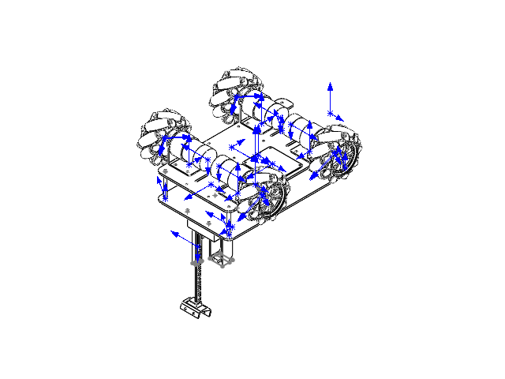
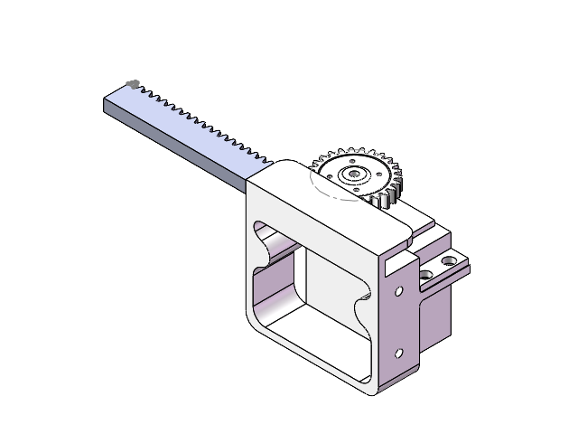

# 七路MG995控制、接线与PS2按键

功能新增于2026-11-01。2026-11-04用户确认齿轮齿条机构是承载K210的升降台，用于调整识别位置，S1对应这一路升降。S2～S7共六路供机械臂使用，具体关节名称、连接关系和角度范围待用户补充。七路已有逐路手动控制代码，均待实物标定。

本次r9增加△升降台直达键，选择该键由开发时确定。当前默认版为`rm_rct6-bench-20261104-r9-safe`，PS2只读版为`rm_rct6-bench-20261104-r9-ps2`，机械臂输出默认关闭。

## 1. 模型能确认什么

已只读检查`C:/Users/fakel/Downloads/机械臂`中的三份ZIP，原件不改动：

- `小车加上升降台哦.zip`：四轮车架、上层板、四根铜柱，以及`mg995_bracket_rebuilt.step`、`mg995_rack100_rebuilt.step`相关支架/齿条实例。没有完整的七关节机械臂装配。
- `c齿轮齿条机构装配体.zip`：装配引用了舵机底座、舵机、圆形舵盘、`圆柱齿轮26×1`和`齿条39×1`。该ZIP只有装配文件，没有这些外部零件原件，读取结果限于保存的装配树和预览。
- `MG995.zip`：一个舵机零件和两种支架零件，不是电气手册。不能从模型、齿轮名称或rack100文件名得出实际行程、允许角度、减速比或安全脉宽。





资料哈希、实例名称与解析范围见[模型记录](reports/arm-cad-20261101.json)。本次没有据新模型重写已经确认的80mm轮径、凹口车头、轮心距和底盘运动学参数。

## 2. 舵机信号接到哪里

沿用已经对照本车原理图的排线，不占用电机USART2、K210 USART3、PS2或下载口。表中JP编号是排针号，不是芯片封装脚号；实物接线先对GPIO丝印及1脚标记。

| 编号 | 当前用途 | RCT6信号脚 | 图纸排针号 | 硬件PWM |
|---|---|---|---|---|
| S1 | 承载K210的升降台，升降方向待标定 | PA6 | JP1-16 | TIM3_CH1 |
| S2 | 暂未分配关节名称 | PA7 | JP1-15 | TIM3_CH2 |
| S3 | 暂未分配关节名称 | PB0 | JP1-20 | TIM3_CH3 |
| S4 | 暂未分配关节名称 | PB1 | JP1-19 | TIM3_CH4 |
| S5 | 暂未分配关节名称 | PB6 | JP3-9 | TIM4_CH1 |
| S6 | 暂未分配关节名称 | PB7 | JP3-10 | TIM4_CH2 |
| S7 | 暂未分配关节名称 | PB8 | JP3-7 | TIM4_CH3 |

PB9/TIM4_CH4继续备用。TIM3/TIM4使用默认映射；主板JP2 LCD口留空，PB6/PB7不同时用于IIC1或重映射USART1。全部供电和K210/驱动/PS2线束见[排线表](WIRING_PLAN.md)。

每台舵机的**信号S**接表中GPIO，**正极与GND**接独立舵机分电支路；舵机地与RCT6共地，大电流回线不经过主控排针。七台MG995不从STM32、USB或驱动板UART的5V脚取电。电源板VADJ能力、本批舵机电压/峰值电流和3.3V信号兼容性仍需资料或实测确认，不因PWM代码完成就视为满足。

## 3. PS2怎样操作

| 按键/摇杆 | 底盘模式：未按L2 | 机械臂模式：持续按住L2 |
|---|---|---|
| 左摇杆上下/左右 | 前后/横移，保持原映射 | 不驱动车轮；推离中心会暂停关节调整 |
| 右摇杆左右 | 旋转，保持原映射 | 不旋转车轮；推离中心会暂停关节调整 |
| 右摇杆上下 | 不用于底盘 | 所选舵机正向/反向调整，需本路已许可且持续按R2 |
| 方向左/右 | 本版不分配底盘动作 | 新按一次选上一/下一路，S1～S7循环；R2须松开 |
| △ | 保留 | 新按一次直接选S1升降台，R2须松开，随后松开△、回中并新按START许可 |
| START | 原底盘回中、新按键解锁流程 | 四轴回中且R2/选路键松开至少300ms，松过START后再新按，许可当前通道 |
| R2 | 本版不分配底盘动作 | 调整使能；松开即停止改变目标，保持最后脉宽 |
| SELECT | 取消底盘/单轮许可，发送PWM0 | 同时冻结舵机目标、撤销机械臂许可；不切断舵机动力 |
| 松开L2 | — | 冻结舵机、撤销机械臂许可；底盘需重新回中、新按START |
| L1、R1、方向上/下、○、×、□、L3/R3 | 保留 | 保留 |

每次只手动调整一台。选路后原许可撤销，要重新回中、新按START；一直按住方向键不会连跳。R2与选路键同时按时不切路、本轮也不移动。当前使用主动按住L2/R2的方式，不使用容易忘记状态的模式切换开关。

操作顺序为保持L2 → 松R2，按△选升降台或用方向左右选择编号 → 松开选路键，四轴回中、START松开并保持至少300ms → 新按START → 持续按R2并轻推右摇杆上下。△只负责选中升降台，升降目标由右Y逐步调整。该流程要求相关配置与验收项均满足。

△按住时回中计时清零，进入L2之前已按住△时需松开重按。R2和△同时操作时当前周期暂停调整，SELECT优先取消许可。切换至S1后，需要重新许可才能输出该路起始脉宽。

上推只表示软件定义的正向；S1是否实际上升，由该路`direction=+1/-1`及实物安装决定。本程序不把齿条文件名或舵机安装朝向猜成实测正负号。

## 4. 默认为什么不会动，在哪里填参数

实际参数集中在[src/arm_config.c](src/arm_config.c)。当前返回全零配置：`enabled=false`，七路`enabled=false`，周期、限位、起始脉宽和速率为0。这些0表示“未填写”，不会输出所谓0度或1500us中位。板级还有[target/board_servo.h](target/board_servo.h)的`RM_ARM_WIRED=0`，默认不会操作舵机GPIO或TIM3/TIM4。

全局要确认的内容：

| 配置项 | 应填写的依据 |
|---|---|
| `enabled` | 明确允许使用机械臂功能；单独改它仍不能输出 |
| `period_us` | 本批MG995手册允许的共同PWM周期，单位us；不要直接沿用其他型号 |
| `wiring_verified` | 七路实际S/+/-、信号电平和主板资源占用已核对 |
| `power_verified` | 独立供电的电压、同时动作/保持电流、接头线缆与压降符合要求 |
| `base_safe_verified` | 操作机构时底盘处于受控静止或动力隔离状态；不能只因为发出PWM0就勾选 |
| `fault_hold_verified` | 已确认该机构允许失联/软件停车时保持最后脉宽，并落实失电保持、防坠落和人工动力切断 |

每路分别填写：

| 配置项 | 含义 |
|---|---|
| `enabled` | 该路是否参加控制；可以只启用已经标定的一路 |
| `min_us`、`max_us` | 已核实的安全脉宽边界，避免齿条冲出或关节顶死 |
| `start_us` | 该路首次许可时要输出的脉宽；应与安全装配初始姿态匹配 |
| `max_rate_us_s` | 每秒允许改变多少us脉宽；不是角速度或毫米速度 |
| `direction` | +1/-1，决定右Y正向对应脉宽增加/减少；0禁止使用 |
| `limits_verified` | 脉宽端点、方向和限速已根据本路实际情况确认 |
| `start_pose_verified` | 首次输出该脉宽不会撞机构或引起危险跳转，机械装配与调试流程已确认 |

软件支持周期1000～65535us、速率1～10000us/s，仅是整数范围和定时器能力边界，**不是MG995建议范围**。实际值必须在实物允许范围内。PC测试中的20ms、1000～2000us、1500us和速率只是假设备夹具，绝不写回生产参数。

机械臂还共用已有`ps2_wiring_verified`、`remote_failsafe_verified`及手柄新鲜度检查。不要求为了单独调机械臂把未知的轮径/轮序/SPD单位改成已验收；底盘安全另由`base_safe_verified`要求实物核对，软件同时强制模式互斥。

## 5. 上电、停车和故障时会发生什么

- 上电时没有通道许可，也没有位置反馈；程序不回中、不自动回零、不预先给七台发送起始脉宽。即使软件配置已完整，首次按START也只初始化当前选中的一路。
- 第一次显式许可某一路时，可能从未知实物姿态转到`start_us`对应位置。程序无法从MG995三线接口读出它当前角度，不能用“慢慢改变目标”消除首次定位的不确定性，因此起始姿态必须单独确认。
- 之后只按时间、摇杆幅度和该路速率修改脉宽；始终夹在该路安全边界内。模型缺少完整关节与传感器，不实现逆运动学、毫米高度控制、碰撞检测或自动归零。
- 松R2停止调整；SELECT、松L2、遥控失效/超时、控制停顿或串口故障撤销许可，保持最后已写入定时器的目标，不补发此前算好但尚未写入的新目标。恢复后需重新回中、新按START。
- 电脑通道/舵机写入故障会锁存机械臂IO故障；电机传输故障按原流程锁存。复位只清软件状态，复位后PWM仍关闭；承重机构必须有合适的机械/电气保护。
- 保持PWM是软件故障策略，不是已实测的位置保持、刹车或断电防坠落。断电、拔线、主控重启后，MG995与机构怎样表现仍需受控验证。

## 6. 在终端和调试器中看什么

沿用CH340、115200/8N1和`reply `前缀，新增的都是只读查询：

```text
ps2
arm
servo 1
servo 7
```

`ps2`增加`right_y`千分比及`buttons`按下位图；L2为0x0100，R2为0x0200，方向左/右为0x0080/0x0020。`arm`显示模式、许可、所选编号、已写入通道掩码、最后脉宽、配置缺项和阻止原因。`servo N`查看该路限位、速率、方向与最后写入脉宽；`ready=1`只表示配置完整，不代表供电/当前通信/硬件已经可操作。

`arm issues`：0x01总开关、0x02周期、0x04接线、0x08供电、0x10底盘安全、0x20故障保持策略、0x40无启用通道、0x80已启用通道参数/验收未完成；默认0x7F。这个表和原`config issues`不是同一张表。

`arm inhibit`：0x001配置或PS2验收、0x002手柄、0x004电机传输、0x008急停、0x010调度停顿、0x020硬件/锁存IO故障、0x040未按L2、0x080所选通道未就绪、0x100停止请求。底盘原`status inhibit`新增0x40表示机械臂模式，不能和此表混用。

调试观察`g_app.arm.selected`为0～6；终端显示1～7。`pulse_us`是本轮待写入目标，`applied_us`/`applied_mask`是最后已接受的硬件写入，不是传感器测得的角度；`milli_us`保存微小调整余量。`g_app.servo_hardware_ready`表示PWM初始化是否成功，默认false是预期。

## 7. 文件职责和验证边界

| 文件 | 负责什么 |
|---|---|
| `src/arm_config.c` | 填实测参数；默认全部关闭 |
| `src/arm_control.c` | 单路选择、独立许可、限位/限速、故障冻结、未写目标撤销 |
| `target/board_servo.c` | HAL TIM3/TIM4初始化、默认映射、整组校验后写CCR预装载；默认不操作GPIO |
| `src/remote_ps2.c` | 完整9字节包解码、右Y和按键位图，坏包清旧值 |
| `src/chassis_app.c` | L2模式与底盘/标定互斥，离开模式后不沿用START许可 |
| `target/main.c` | 电机命令先发送，写舵机前再检查错误，成功才提交目标 |
| `tests/test_arm.c`、`test_arm_main.c` | 模拟配置、限位、失联、计时回绕、模式切换及写入前故障 |

11月1日的开发结果见[原交付报告](reports/ARM_CONTROL_2026-11-01.md)，r6结果见[驱动收尾报告](reports/DRIVER_FINALIZATION_2026-11-02.md)。

## 8. 2026-11-04升降台独立键验证

r9增加△直达S1，用户确认该路为K210升降台。S2～S7已有六路独立限位、限速与许可代码，实际关节分工和标定继续按实物填写。七路配置全零，首次许可条件与供电等验收项仍待完成。

PC回归通过，机械臂八组共42667条断言，覆盖从机械臂通道直达S1、原通道保持、重新许可、长按△、进入模式前按住△、R2/SELECT组合及关闭通道。核心129334条断言、底盘主循环32场景、服务745条断言、PS2专项6580项和机械臂主循环11场景通过。

默认、PS2只读及PS2/舵机接口启用三个ARM构建与ELF/HEX/BIN检查通过。新产物、源码输入与日志哈希见[本次清单](reports/lift-shortcut-artifacts-20261104.json)。备份和原始日志位于`work/lift-shortcut-20261104/`，Git修改保留为待审核状态，硬件验证待执行。

正常工具入口在Windows PowerShell 5.1下通过17项日志检查、7项联调工具检查和43项回复检查。跨PowerShell版本继承的模块路径曾导致工具测试找不到`Get-FileHash`，在测试进程内使用Windows PowerShell模块路径后通过。构建脚本处理中文路径时使用进程内`PYTHONUTF8=1`。
