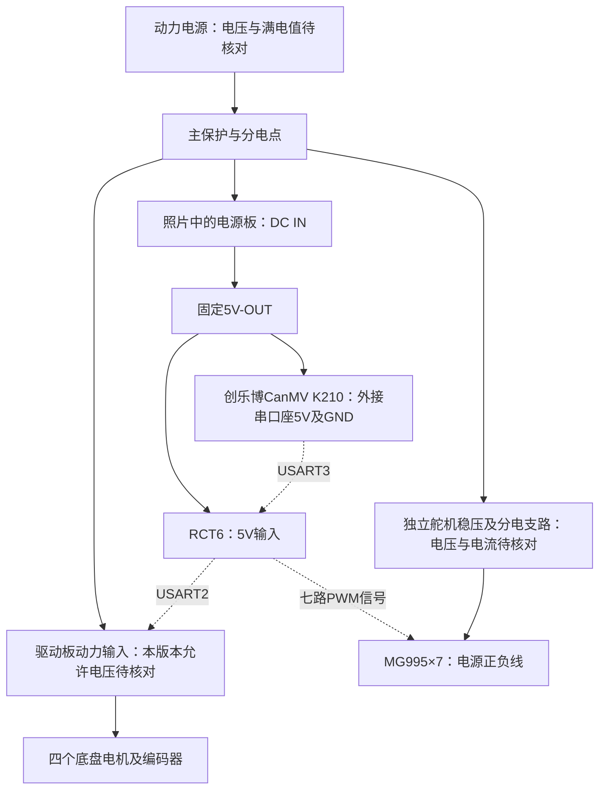

# RCT6整车排线安排：K210、七台MG995、四路电机驱动

2026-11-04用户确认3S满电12.6V输入可用，主控仍经固定5V稳压支路。用户选择SELECT/电脑stop软件急停，r8按人工看护、四轮架空流程验收，见[今晚入口](TONIGHT_BRINGUP.md)。下方带日期的r6独立停车要求保留历史，当前执行上述用户最新范围。

日期：2026-10-26。用户本次确认的数量为1台K210、7台MG995、1块四路驱动板，STM32从照片中的电源板取电。此前四台SG90的设想不再作为当前配线数量。原有PS2及三条灯带继续预留接口；本轮只安排线路，不实现新固件、不通电、不烧录、不做运动测试。

2026-10-26整理时的r4只实现底盘和PS2等已有功能。2026-11-01的r5已按下表实现七路PWM与PS2手动控制，仍默认禁用，详见[ARM_CONTROL.md](ARM_CONTROL.md)；K210 USART3尚未实现。接上信号线不代表已通过电平、机构限位或供电验收；2026-11-02用户已确认SPD为轮缘mm/s，驱动无超时停车；r6加入轮径门禁及只读诊断，实物轮向和外部独立停车硬件仍未验收。排线不因软件构建而视为通电通过。

## 1. 供电和信号分开走

电源负极、驱动GND、RCT6 GND、K210 GND和舵机电源GND接成共同参考地。驱动和舵机的大电流回路各自直接回分电点，不串过RCT6的GND排针、USB线或细信号线。信号束带参考地，电源回路线应足以承担相应负载，不能只接信号而省掉共地。

| 起点 | 终点 | 配线安排 |
|---|---|---|
| 动力电源支路 | 电源板DC IN的+、− | 按照片丝印核极性；本板输入标6～24V，仍核对实物版本及实际电源满电值。多个输入接口只选一种供电，不接多个电源 |
| 电源板固定5V-OUT正极 | RCT6的5V排针 | 原理图为JP3-29或JP3-31；只选一对合适连接，5V进板载稳压器，不进3V3或GPIO |
| 电源板GND | RCT6 GND | 原理图可用JP3-30或JP3-32；不要把邻近信号脚当GND |
| 电源板另一个固定5V输出接点 | 创乐博CanMV K210外接串口座的5V、GND | 按本次实物照片的5V/GND丝印；两个输出接点仍共用同一条5V能力，需核对主控与视觉板合计负载和电压跌落，不从STM32排针串接K210 |
| 动力电源的电机支路 | 驱动蓝色VIN+/VIN− | 用户本轮确认3S满电12.6V输入可用。按该确认安排，接线前核实际电压、极性和实物驱动版本，主控另走稳压5V支路 |
| 独立舵机稳压器/已验证的大电流支路 | 七路舵机分电端子 | 正极接七台V+，负极接七台GND，七路信号分别接下表；电源电压、峰值和持续电流按这批MG995资料确认 |
| 电源板3V3-OUT | 本次留空 | RCT6用5V输入；不同时把外部3V3和板载3V3输出并联 |
| 电源板VADJ-OUT | 暂不接七台舵机总电源 | 仅确认了可调输出接口，未取得该版本可承受七舵机合计电流的证据；不能因插针多就按七路独立电源使用 |

**STM32不替七台舵机供电。** 舵机电源不从STM32的5V/3V3针取，不从驱动UART口5V取，也不把两个稳压器正输出并接。同一电源板上同颜色的多对插针共享输出，不会把可承受总电流成倍增加。

七台MG995的电源支路按实际同时动作/保持负载的电流总和与余量选型，另核对分电端子、接头、线缆、保护器件和散热。没有本批舵机峰值数据前，不给出“某固定安数一定够”的结论。需要补足时只补舵机支路，不必更换STM32或整套系统；若后续证明现有VADJ满足电压、电流及热条件，可再修订支路来源。

## 2. STM32与四路驱动板

保持原程序USART2配置，使用3.3V兼容TTL信号，115200/8N1/无流控。照片右侧靠上的PH2.0口标为串口，另一个是IIC，本方案不接IIC。

| RCT6信号 | 图纸排针编号 | 驱动板端 | 线标 |
|---|---|---|---|
| PA2 / USART2_TX | JP1-12 | RX2 | MOTOR_TX |
| PA3 / USART2_RX | JP1-11 | TX2 | MOTOR_RX |
| GND | 如JP1-30/32 | UART GND | MOTOR_GND |
| 不连接 | — | UART 5V | 空位保留，不能与电源板5V并联 |

按接口丝印核对5V/GND/TX2/RX2，不按照片左右、插头能否插入或线色直接认定针序。底盘编码器和电机都接四路板，不接主控舵机PWM引脚；编码电机的六针线序仍按[已有交接](../RM_CODEX_HANDOFF.md)逐功能转接，不能拿未核对的PH2.0直通线直接接。

四轮候选分配仍为M1左前、M2左后、M3右前、M4右后，凹口为车头；实际通道与方向留到逐轮验收。驱动板Type-C用于它自身的串口调试，不替代本方案的TTL接线，也不能与RCT6的Type-C当作两板互通口直接连接。

## 3. STM32与K210

2026-10-26照片更新：商品参数图标称`CanMv K210S`，实物印有“创乐博”和`CanMV K210`，按创乐博CanMV K210系列安排，不再按Maix Bit、01Studio mini或KD233接线。照片未显示PCB修订号，不能宣称某个细分版本的完整原理图已核对。外接白色四针座旁可读出P7/TX、P6/RX、GND、5V；下表依据这些实物丝印，不靠其他厂商的同名板推断。

| RCT6信号 | 图纸排针编号 | K210端 | 说明 |
|---|---|---|---|
| PB11 / USART3_RX | JP1-21 | 外接四针座P7 / TX | K210回传识别结果走这根线，TX接RX |
| PB10 / USART3_TX | JP1-22 | 外接四针座P6 / RX | 预留主控发送请求/状态，TX接RX；先只接收时可留空 |
| GND | 如JP1-30/32 | GND | 共参考地 |
| 不接STM32的电源针 | — | 外接四针座5V | 由电源板固定5V独立支路接入，不能接PB10/PB11 |

STM32一侧使用USART3默认映射、异步无硬件流控；不使用PB12～PB15上的CK/CTS/RTS功能，因此不占PS2。照片的5V表示供电脚，不代表TX/RX是5V逻辑。尚未取得此PCB版本的完整原理图或测得串口高电平，接通信线前核对其与STM32的3.3V输入输出要求匹配；如实际为1.8V或其他电平，先做匹配，不由“支持Arduino”宣传文字推定可以直连。

**算法侧采用外接座P7作为发送、P6作为接收的约定。** 这两个角色来自实物丝印，仍要在现有CanMV程序中检查相应FPIOA/UART映射及占用；照片不能证明当前程序已经初始化或正在回传。若算法程序原先占用P6/P7，先统一资源和回传程序，不带电改接其他针。双方波特率、帧格式和校验届时一起确定，目前候选115200不是已协商或实测的结果。

旧交接的Maix Bit及本机`Downloads/k210/board_config.h`中BOARD_KD233、`main.c`中IO34 TX/IO33 RX均不作为本板接线依据。本次没有修改或移植该程序。CanMV的软件背景见[官方项目](https://github.com/kendryte/canmv)，品牌产品背景见[创乐博官网](https://www.loborobot.com/)；尚未取得此K210S版本的完整配套原理图和UART例程，不把01Studio等其他板资料当成本板证据。

外接四针座按信号名逐根转接，不按线色、插头左右或同为四针就直接插入。仅制作一束四芯线时，5V/GND在分线处去电源板，TX/RX去RCT6，不把四根都插入主控四个相邻GPIO。K210 Type-C留给它自身下载/IDE，不与RCT6 Type-C互连；没有确认防反灌设计前，USB与外部5V分时使用，不能两路同时供电。

## 4. 七台MG995信号线

优先用两组硬件定时器输出，避免用软件延时挨个生成脉冲。TIM3四路、TIM4三路，各通道独立脉宽；采用默认映射，不重映射到PC6～PC9，也不使用板载LED的PA8。S1～S7只是线束编号，关节/夹爪名称等机构确认后再填。

| 舵机编号 | RCT6信号 | 定时器 | 图纸排针编号 | 舵机端 |
|---|---|---|---|---|
| S1，K210升降台 | PA6 | TIM3_CH1 | JP1-16 | S1信号S |
| S2 | PA7 | TIM3_CH2 | JP1-15 | S2信号S |
| S3 | PB0 | TIM3_CH3 | JP1-20 | S3信号S |
| S4 | PB1 | TIM3_CH4 | JP1-19 | S4信号S |
| S5 | PB6 | TIM4_CH1 | JP3-9 | S5信号S |
| S6 | PB7 | TIM4_CH2 | JP3-10 | S6信号S |
| S7 | PB8 | TIM4_CH3 | JP3-7 | S7信号S |
| 备用S8，暂不接 | PB9 | TIM4_CH4 | JP3-8 | 留空 |

以上GPIO与主板LCD排座JP2部分信号有共用：PB6/PB7/PB8/PB9。因此主控JP2 LCD口本方案留空，也不在PB6/PB7启用IIC1，不重映射USART1到PB6/PB7。K210自身的显示屏是另一块板上的资源，需在其板端另查占用。

每台舵机三根线：`S`接表中信号，`V+`接独立舵机电源，`GND`回舵机分电地，分电地与STM32地相通。常见线色仅供辨认，最终按该批线序资料核对；不能把整只三针插头随意插到STM32三个相邻GPIO上。

PWM为STM32的3.3V信号，须确认这批MG995输入高电平门限；如果不能可靠兼容，预留单向电平缓冲，不把外部5V送回GPIO。r5已实现PWM、逐路限位/限速和故障冻结，但未擅自写死频率、脉宽上下限、角度或中位，也不让上电自动回中；电气和机械限位核实、填入配置后才能启用。

## 5. 保留PS2、下载和灯带接口

| 用途 | GPIO | 图纸排针编号 | 安排 |
|---|---|---|---|
| PS2 ATT/CS | PB12 | JP1-24 | 保留原GPIO |
| PS2 CLK | PB13 | JP1-23 | 保留原GPIO |
| PS2 DAT | PB14 | JP1-26 | 保留原GPIO |
| PS2 CMD | PB15 | JP1-25 | 保留原GPIO |
| CH340下载/终端 | PA9/PA10 | JP3-23/24，板上已连接CH340 | 不再接K210或舵机 |
| SWD | PA13/PA14 | 板上JP5接口 | 留给后续调试 |
| 原生USB | PA11/PA12 | 板上J2 | 保留，不用来给新外设分配GPIO |
| 红/绿/蓝灯带控制候选 | PC4/PC5/PC6 | JP1-18/17/28 | 只预留逻辑控制；灯带类型/电压/驱动未知，不接灯带电源或负载 |

PS2供电和DAT电平仍按[PS2资料依据](PS2_REFERENCE.md)核实。PB12～PB15的GPIO保持不变；本次发现旧文档JP1物理针号错了一排，已纠正为24/23/26/25。原理图的JP1-21/22实际是PB11/PB10，不能再按旧针号接PS2。

上述JP1/JP3数字是连接器针号，不是STM32芯片封装脚号。必须找到实物对应的排针、1脚标记和GPIO丝印后再对照；原理图符号的左右不代表从板底看也相同。无法确认实物方向时先不插，断电后用通断档核实GND/5V；不要把“相邻一排”当作针号依据。

## 6. 线束和摆放

| 线束 | 内容 | 推荐安排 |
|---|---|---|
| PWR-MCU | 5V、GND | 电源板直达RCT6，正负极两端贴标签；不串接舵机负载 |
| PWR-K210 | 外接四针座5V、GND | 单独回到固定5V分电点，留出摄像头运动及维修余量 |
| MOTOR-UART | PA2 TX、PA3 RX、参考GND | 带锁止PH2.0转接到正确针序，远离电机动力线 |
| VISION-UART | PB10 TX→P6/RX、PB11 RX←P7/TX、参考GND | 已按实物丝印定位置，逻辑电平及程序映射核对后再接通 |
| SERVO-S1～S7 | 各路S、V+、GND | 经明确标有S/+/-的七路分电端子；每根同时标舵机编号和GPIO |
| PWR-SERVO | 舵机稳压输出正负主线 | 用额定电流足够的端子、线缆和保护，单独走线；不把七路主电流压到一根细杜邦线或普通面包板 |
| PS2 | 原四信号、适配供电、GND | 与舵机/电机大电流线分束，保留检修余量 |

驱动板靠近底盘电机，舵机分电靠近机械臂，RCT6信号线从中间分两束去驱动与机械臂。线不要擦轮胎、齿轮或关节，活动处留弯曲余量和固定点；长距离紧贴动力线的串口线优先改路径，确实不可避免时再设计合适的通信物理层。地线短而可靠，电源回路与信号回路按功能布置。

电源板开关只控制自己的输入支路，不能据此认定它能切断另行接电的驱动或舵机。主保护、动力切断及机械臂失电保持需要按实际负载设计，尤其机械臂掉电是否坠落，不能直接套底盘停车策略。

## 7. USB下载时怎样切换

本RCT6原理图的两个USB VBUS和排针5V是同一电源网，未见自动隔离。本方案的日常工作状态由电源板给STM32供电；使用普通A转C线下载时，先断开外部电源对STM32的5V供电并隔离其他模块信号/动力，按[USB_ISP.md](USB_ISP.md)做单板下载，防止两路5V并联或经信号脚反向供电。不要仅因没有下载动作就把USB和外部5V同时接上。

若以后需要“外部供电同时看电脑串口”，再使用经过确认的电源隔离/防反灌方案，或不带供电连接的独立3.3V USB-TTL接口；该接口接USART1时也需核对板载CH340的占用和输出冲突，本轮不把它作为已验证操作步骤。

## 8. 依据、状态与还需要补齐的点

- 用户本轮三张图片：驱动PH2.0串口/IIC、蓝色动力端子以及电源板固定5V/3V3/VADJ输出。图片支持接口识别，不支持峰值电流、实际线序或实物供电已验收。
- 后补三张K210照片：商品参数图标`CanMv K210S`，实物图可读创乐博、CanMV K210及P7/TX、P6/RX、GND、5V接口。源照片路径和SHA256记录在工作目录`work/wiring-plan-20261026/k210s-photo-review/before.json`。型号/端口识别来自用户图片；未据此确认串口逻辑电平、实际运行固件、波特率或通信已成功。
- [本车原理图](../references/双TypeCF103RCT6原理图.pdf)，SHA256 `08fd8b0b3f16e9cc6569d350b770197c14290f16f73b52e9c418a5ea0fb5ae6d`：已重新放大并核对JP1、JP3、JP2、板载按键/Flash/LED和USB供电网。工作目录`work/wiring-plan-20261026/`保存截图、修改前文档与针号提取记录。
- [ST DS5792 Rev13](https://www.st.com/resource/en/datasheet/stm32f103zc.pdf)，表5、文档第32/33/36页：核对TIM3/TIM4七路PWM及PB10/PB11 USART3资源。未启用TIM3/TIM4或USART3，也未修改HAL/时钟。
- [Sipeed Maix Bit页面](https://wiki.sipeed.com/hardware/en/maix/maixpy_develop_kit_board/maix_bit.html)只保留作旧交接核对记录，不用于当前创乐博K210板的针序、电气规格或供电能力。
- [亚博当前同类稳压模块说明](https://www.yahboom.store/products/asrm)和[教程](https://www.yahboom.net/study/ASRM/)不替代用户照片中旧版本的各轨额定电流。本方案不借用名称相似的YB-MPP01树莓派5电源板5A参数。
- TowerPro网站的[旧MG995链接](https://www.towerpro.com.tw/product/mg995/)当前跳转到MG996R产品；本方案未将升级型号的电流、角度和脉宽范围写成这七台MG995的规格。

后续只补以下实际信息：这款创乐博K210的配套原理图/例程、现有算法程序和固件版本，用来核对P6/P7映射与逻辑电平；七台MG995的线序、电压/峰值电流/输入门限及关节分工；电源板对应版本的电流规格；动力电源满电电压。品牌、商品型号和外接端口位置已有图片依据，不再笼统要求重找K210型号。未核实的电源能力/信号电平端口暂不通电接通，线标和已确定的位置可以先准备。

10月26日只整理文档和针号，未改固件。11月1日机械臂软件与r5构建另见[本轮报告](reports/ARM_CONTROL_2026-11-01.md)；仍未烧录、实测、提交或推送，全部生产运动禁用默认值保持。
